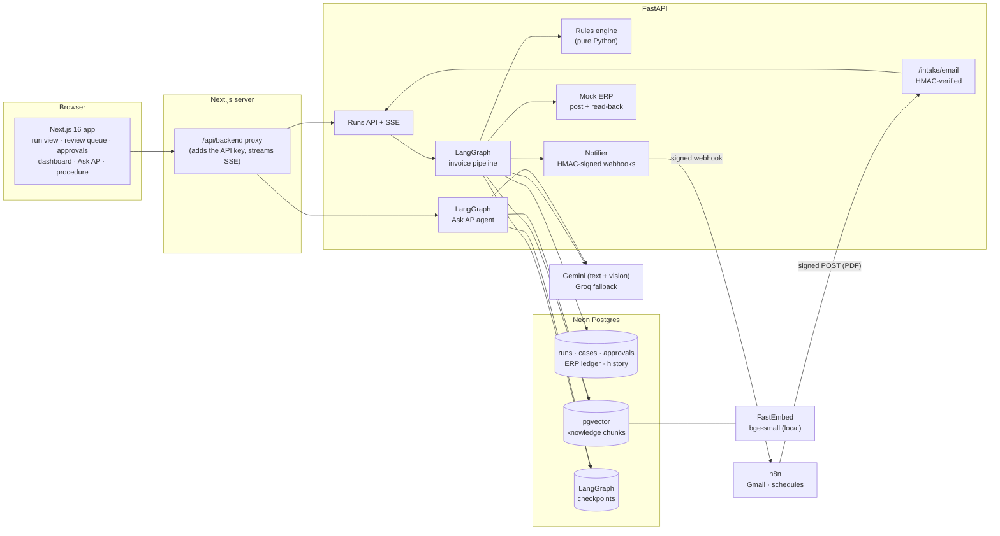
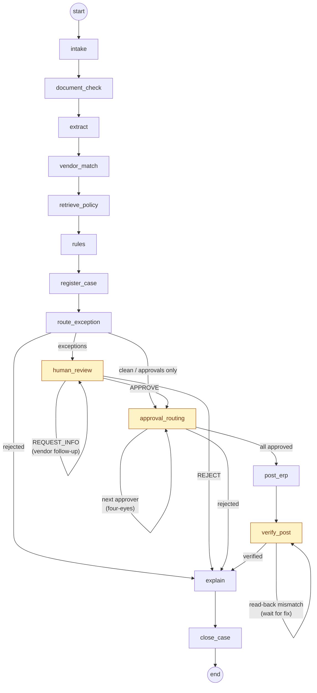
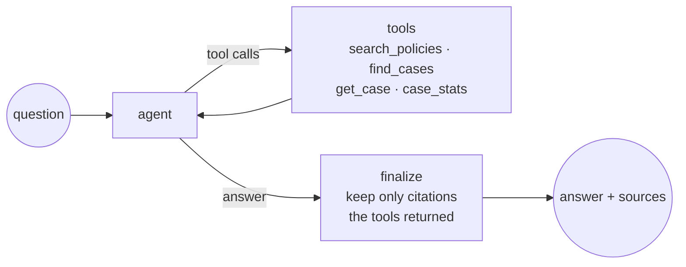

# Sinoprex Invoice

**Agentic AI invoice processing for accounts payable.** A vendor invoice PDF goes in, by upload
or email, and a reasoned, cited, auditable decision comes out: `APPROVED`, `NEEDS_REVIEW`,
`ON_HOLD` or `REJECTED`. When a case is approved, it is posted to an ERP and the posting is
verified by reading it back.

> **The AI reads and retrieves. The rules decide. A person approves the uncertain cases.**

It's built for a fictional Indian retailer, Acme Retail Pvt Ltd in Bengaluru, with GST, PO/GRN
three-way matching, vendor contracts and an approval matrix. All data is dummy data.

## The problem

AP clerks re-key invoices, hunt for the PO and goods receipt, check prices against contracts,
spot duplicates and changed bank details, and chase approvers. They do this by hand, under time
pressure, with little audit trail. Most invoices are clean and could flow straight through. The
hard part is the 20–30% that are not: someone must see exactly *why* a case was stopped, *which
rule or clause* says so, and *who* has to act.

Sinoprex Invoice automates the clean path end to end and turns every exception into one specific
question for a named owner, with the evidence attached.

## What it does

| | |
|---|---|
| **Read** | Gemini extracts every field from text or scanned PDFs, with page/box evidence and calibrated confidence. Low-confidence fields go to a person, never into a guess. |
| **Retrieve** | Hybrid RAG (pgvector + Postgres full-text, reciprocal rank fusion) finds the vendor's contract clauses and the AP policy. Contract rates are only used when a cited clause states them. |
| **Decide** | A deterministic rules engine (about 20 checks: GST, arithmetic, duplicates, PO/GRN/contract matching, tolerances, vendor status, bank changes, approval matrix). Every check cites its policy section or contract clause. |
| **Pause for people** | LangGraph `interrupt()` stops for review or approval, survives restarts (Postgres checkpointer) and resumes exactly where it stopped. Overrides need a second approver (four-eyes). |
| **Post & verify** | Posts to the ERP idempotently (ERPNext through its connector app, or the built-in mock ERP), reads the document back and compares it field by field. A one-paisa mismatch keeps the case open. |
| **Pay** | A payment run proposes what falls due before the next payment day (Tuesdays and Fridays), holds anything with a changed bank account or an open exception, and pays nothing until a named person releases the batch. Payouts go through RazorpayX (test mode works with no real money); a signed webhook marks the invoice PAID with the bank's UTR. |
| **Explain** | An LLM writes a short summary that may only cite sources the rules used. Everything goes into an evidence bundle (JSON + PDF). |
| **Ask AP** | A tool-calling agent answers "Why was the TechNova invoice flagged?" from the cases and the knowledge base, with citations. It says so when it doesn't know. |
| **Automate** | A built-in **Apps marketplace** (modelled on DevRev snap-ins): install Gmail Inbox Intake, Reviewer Alerts, Vendor Follow-up, Daily Summary, Slack Alerts or the n8n Connector, fill in a settings form, pick a connection and activate. Credentials are encrypted and write-only. |

## Architecture



### The invoice pipeline (LangGraph)



The highlighted nodes pause with `interrupt()`. The case waits in the review queue or the
approvals inbox, and the Postgres checkpointer keeps it across server restarts. Every node
streams `step_started` / `step_finished` events to the browser over SSE, and any node error ends
the run as `FAILED` with the message (it never hangs).

### Ask AP (second graph)



## Why each tool

| Tool | Why it's here |
|---|---|
| **LangGraph** | The pipeline is a real state machine: conditional routing, `interrupt()` for human review and approvals, a Postgres checkpointer so paused cases survive restarts. The Ask AP agent is a second, small graph. |
| **FastAPI** | Async API, typed request/response models (the OpenAPI schema generates the frontend's types), SSE streaming. |
| **Gemini + Groq** | Gemini reads scanned PDFs (vision) and text. Groq is the text fallback when Gemini is overloaded, and a lighter Gemini model is the last resort. All have free tiers. |
| **Rules engine (plain Python)** | Money decisions must be deterministic, unit-tested and explainable. The LLM never decides. |
| **pgvector + full-text + RRF** | Contract and policy text needs both meaning (dense vectors) and exact terms ("GRN", "IGST", rates). A relevance gate means "nothing found" rather than a weak guess. |
| **FastEmbed (bge-small)** | Local embeddings: no API cost or rate limits, the same vectors everywhere. |
| **Neon Postgres** | One free serverless database for business data, vectors and LangGraph checkpoints. |
| **Next.js 16** | App Router UI with a server-side proxy, so the API key never reaches the browser. TanStack Query for data, Recharts for the dashboard. |
| **Apps platform** | Email, reminders and schedules are configured in the UI, not in code: apps declare inputs, connections, events and timers in a manifest; the platform validates, runs, logs and audits them. n8n stays available as an optional app. |
| **Fernet (cryptography)** | Connection secrets are encrypted with a key that lives outside the database (`SECRETS_KEY`), rotatable with MultiFernet, never returned by the API. |
| **Playwright** | End-to-end tests drive the real app on a throwaway stack (recorded LLM outputs, temp SQLite) in the installed Edge. |

## Edge cases covered

Twenty-five generated invoices (four layouts, three scans), each with ground truth for every field,
the decision, the exceptions and the citations (`data/test-invoices/`):

| Case | Expected |
|---|---|
| Clean three-way matches (intra- and inter-state GST), a partial invoice that completes a PO, a price 1.2% over the PO (inside tolerance) | APPROVED |
| Scanned invoices: good, skewed, and poor quality (poor → low-confidence fields go to a person) | APPROVED / NEEDS_REVIEW |
| Split invoicing: three invoices against one PO, the third goes over the PO balance | NEEDS_REVIEW |
| Unit price above the contracted rate (contract clause cited) | NEEDS_REVIEW |
| Exact duplicate / likely duplicate with a new number | REJECTED / NEEDS_REVIEW |
| No PO number (PO inferred and confirmed by a person) · non-PO SaaS subscription (coded, department-head approval) | NEEDS_REVIEW |
| Bank details changed (fraud signal → hold, two approvers) | ON_HOLD |
| IGST on an intra-state supply · totals that don't add up · quotation or credit note sent as an invoice | NEEDS_REVIEW / REJECTED |
| Above ₹5 lakh (Finance Manager approval) · goods not yet received (no GRN) · blocked vendor · unknown supplier | NEEDS_REVIEW / ON_HOLD / REJECTED |
| ERP read-back mismatch (the mock ERP drops a paisa) | stays open until fixed |

## Evaluation

`python -m scripts.eval --live --rag --write` runs all 25 samples through the real graph (fresh
database, manifest order) and the RAG question set. Full results are in
[docs/EVAL_RESULTS.md](docs/EVAL_RESULTS.md), and the latest numbers are shown on the dashboard.

<!-- eval-summary:start -->
| Live run, 2026-11-18 (Gemini flash-lite + fallbacks) | |
|---|---|
| Decision accuracy (25 invoices) | **100%** |
| Field-level extraction accuracy (560 fields) | **100%** |
| Exceptions and expected citations | 100% / 100% |
| Time to decision (median / p90) | 30 s / 53 s |
| LLM calls / tokens per invoice | 4.8 / ~3.9k |
| Retrieval hit-rate@5 / MRR (18 questions) | 94% / 0.75 |
| Answer correctness (LLM judge) | 84% |

Free-tier Gemini was often overloaded: fallbacks caught 65 failed calls, but 9 cases still needed
a rerun. Extraction and contract reading now retry 503/429 errors with back-off (8 s, 30 s)
before a case fails.
<!-- eval-summary:end -->

## Apps (automations)

Open **Apps** in the sidebar. Each app is a manifest (`backend/app/apps/builtin/*.py`) with:

| Manifest part | DevRev snap-in equivalent | Example |
|---|---|---|
| `inputs` (typed fields) | inputs | reviewer emails, reminder hours, send-at time |
| `connections` | keyrings / connections | "Send from: a Gmail account" |
| `events` | event sources | `case.waiting_review`, `case.request_info`, `case.closed`, `case.failed` |
| `timers` | timer event sources | "check the inbox every N minutes", "daily at 09:00 IST" |
| `on_validate` / `on_activate` | hooks | log in to Gmail before activating |

Lifecycle: **Install** (draft) → **Activate** (validated; on failure the app shows *Needs attention*
with the reason) ⇄ **Pause** → **Uninstall**. Every run is logged (OK / SKIPPED / ERROR, with
duration and the case it touched) and every change is audited with who made it.

**Secrets.** A connection's secret (Gmail App Password, Slack webhook URL, n8n signing secret) is
encrypted with Fernet before it is stored; the key (`SECRETS_KEY`) is a server setting, not in the
database. The API never returns a secret, only "set", its last 4 characters and when and by whom it
was set; you can replace or remove it. Secrets are decrypted only in memory while an app runs, and
scrubbed from run logs and error messages. Rotate by putting a new key first in `SECRETS_KEY`.

| App | What it does |
|---|---|
| Gmail Inbox Intake | Polls a Gmail inbox (IMAP; only unread mail sent *to* the chosen address with a PDF), creates cases, replies with references, marks the mail read. Redeliveries never duplicate. |
| Reviewer Alerts | Emails reviewers (or approvers) when a case waits, with the question and a deep link; one reminder after N hours. |
| Vendor Follow-up | When a reviewer requests information, emails the vendor (or a demo inbox) the drafted, cited follow-up. |
| Daily Summary | A morning digest of what came in, what was decided and what is waiting. |
| Slack Alerts | Posts selected case events to a Slack channel. |
| RazorpayX Payouts | On each payment day, proposes a payment run (see *Payments* below). Sends the payouts of a released batch through RazorpayX and checks every 30 minutes on any still in flight. |
| Payment Advice | Emails the vendor (or a demo inbox) when a payment reaches the bank: invoice, amount, mode, account (last 4 digits) and UTR. |
| ERPNext Connector | Posts approved invoices to ERPNext as submitted Purchase Invoices and reads them back from ERPNext; records each payout as a Payment Entry with the UTR. "Run now" creates the suppliers, cost centres and accounts the postings need. Paused, postings go to the mock ERP. |
| n8n Connector | Keeps the original n8n workflows working (signed webhooks both ways). Existing `N8N_*` settings are moved into it on first start. |

## Payments

The **Payments** page lists every posted invoice with its due date (invoice date + the vendor's
payment terms) and where it stands: *not due yet*, *due* in the next run, *on hold* (with the
reason), *proposed*, *in flight*, *paid* (with the UTR) or *failed* (with RazorpayX's reason).

1. On a payment day the RazorpayX Payouts app proposes a batch: everything due before the next
   payment day, so nothing is paid late. Holds keep an invoice out: blocked vendor, no bank
   account on file, ERP write not verified, open exceptions or approvals, or bank details on the
   invoice that differ from the vendor master (released only after the master is checked,
   ap-policy §6.2).
2. Automation never releases money (ap-policy §1.3): a person releases the batch, in their name.
3. Each payout is sent with an idempotency key (`<document>:<attempt>`), so a retried request
   can't pay twice. RazorpayX's `payout.processed` / `failed` / `reversed` webhooks
   (`POST /webhooks/razorpayx`, HMAC-signed, no API key) update the payment; a half-hourly sync
   catches a missed webhook.
4. Paid: the ERP document becomes PAID with the UTR and the vendor gets a payment advice. Failed:
   the invoice comes back with the reason and is retried only after someone says so.

To try it, create a RazorpayX account in test mode, add a **RazorpayX account** connection
(account number, key id, key secret, webhook secret) and activate the app. Add a webhook in
RazorpayX pointing at `<API URL>/webhooks/razorpayx` with the payout events.

## ERPNext

[ERPNext](https://erpnext.com) is a free, open-source ERP with Indian GST support and a REST API.
With the **ERPNext Connector** app active, `post_erp` creates a submitted **Purchase Invoice**:
the supplier found by GSTIN, one line for the net amount with the GL account (matched by account
number) and cost centre we coded, GST as an "Actual" tax row, the case id in the remarks and
the invoice file attached. `verify_post` then reads the document **from ERPNext** and maps it
back (supplier → vendor, account → GL number), so the same field-by-field check catches anything
ERPNext changed. A retry finds the existing document by case id or supplier + bill number.
A local copy goes into the ledger, so payments and the dashboard work the same. When a payout
is processed, a **Payment Entry** (reference = UTR) is submitted against the invoice and
ERPNext marks it Paid. Self-hosting: [deploy/erpnext](deploy/erpnext) and
[DEPLOY.md](deploy/DEPLOY.md) § 8.

## Run it locally

Prerequisites: Python 3.12+ with [uv](https://docs.astral.sh/uv/), Node 20+ with pnpm, a free
[Neon](https://neon.tech) project, and a `GOOGLE_API_KEY` (Gemini). `GROQ_API_KEY` is optional.

```bash
# backend
cd backend
cp .env.example .env            # DATABASE_URL (Neon direct URL), GOOGLE_API_KEY, API_KEY, …
uv sync
uv run alembic upgrade head     # tables + pgvector
uv run python -m scripts.seed   # vendors, POs, GRNs, invoice history
uv run python -m scripts.ingest_knowledge   # index data/knowledge into pgvector
uv run uvicorn app.main:app --reload --port 8000 --loop app.loop:selector_loop_factory
```

```bash
# frontend
cd frontend
cp .env.example .env.local      # API_URL=http://localhost:8000 and the same API_KEY
pnpm install
pnpm dev                        # http://localhost:3000
```

Try a sample from the **New run** page, then **Review queue**, **Approvals**, **ERP ledger** and
**Ask AP**. **Settings → Reset demo** starts over (the samples depend on run order).

On Windows, the `--loop` flag is needed (psycopg can't use the Proactor event loop), and if
compiled packages fail to import from a long path, point `UV_PROJECT_ENVIRONMENT` at a short
folder.

**n8n (optional):** see [n8n/README.md](n8n/README.md) for the four workflows, the signing
scheme, the tunnel and the pre-fill script.

## Checks

```bash
cd backend  && uv run ruff check . && uv run ruff format --check . && uv run mypy app scripts tests && uv run pytest
cd frontend && pnpm lint && pnpm typecheck && pnpm build
cd frontend && pnpm e2e        # Playwright: builds, starts a throwaway backend + frontend, runs in Edge
```

Other scripts (from `backend/`):

| Command | What it does |
|---|---|
| `uv run python -m scripts.eval [--live] [--rag] [--write]` | End-to-end evaluation (see above) |
| `uv run python -m scripts.eval_extraction [--record \| --replay]` | Extraction accuracy; record fixtures |
| `uv run python -m scripts.eval_rag [--pg] [--answers]` | Retrieval hit-rate / judged answers |
| `uv run python -m scripts.generate_invoices` | Regenerate the 25 test PDFs + ground truth |
| `uv run python -m scripts.export_openapi` then `pnpm gen:api` | Refresh the frontend's API types |
| `uv run python -m scripts.n8n_prefill <tunnel-url>` | n8n workflow copies with secrets filled in |

## Layout

```
backend/   FastAPI app: app/{api,graph,rules,rag,extraction,llm,assistant,integrations}, alembic/, scripts/, tests/
frontend/  Next.js App Router UI (app/), components/, lib/, e2e/ (Playwright)
data/      seed/ reference data · knowledge/ RAG corpus · test-invoices/ PDFs + ground truth · eval/
docs/      EVAL_RESULTS.md (live evaluation numbers)
n8n/       workflow exports + setup
deploy/    Docker Compose, Caddyfile and DEPLOY.md (Oracle VM + Vercel + Neon)
```

## Deploy

[deploy/DEPLOY.md](deploy/DEPLOY.md): frontend on Vercel; FastAPI, n8n and Caddy (automatic
HTTPS) on an Oracle Cloud Always Free ARM VM; database on Neon. Total ₹0 on free tiers.

## What's next

- Real users and roles. Today there is one optional shared password (`SITE_PASSWORD`),
  approvers are names, and four-eyes is checked by name.
- More ERP connectors behind the `ErpProvider` interface (Tally / SAP B1 / Zoho Books), and
  posting against ERPNext purchase orders and receipts instead of a single expense line.
- TDS deduction on payouts, MSME 45-day payment tracking and early-payment discounts.
- File storage on R2/S3 instead of local disk; a queue + worker split for scale.
- Vendor portal: vendors answer follow-ups and upload corrected invoices directly.
- More layouts and real-world scans in the evaluation set; per-vendor extraction accuracy over time.
